# bu1ld0r

A 3D model builder in QB64 Phoenix Edition. Put simple shapes together
(boxes, cylinders, spheres, cones, wedges and tubes; dice from 4 to 30
faces, stars, gears, donuts, diamonds, spikes, pills and arrows), size,
turn and colour them, and save the model. It saves as its own file to edit again, as an
OBJ for any 3D program, and as a ready-made NEON-CASTER prop.

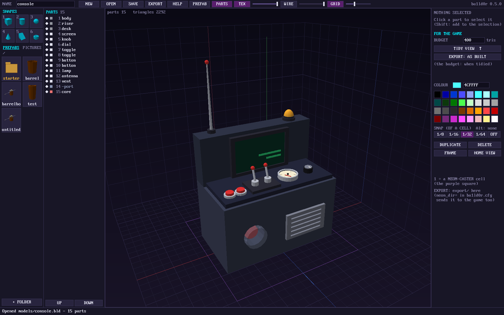

Save what you build as a prefab and it goes in the bin, ready to drop
onto another model's faces, linked: change the prefab and every model
using it changes.

Any part can be a hole (cut out of the parts before it) or a KEEP (only
the overlap stays), live, and made permanent when you're happy. Any part's
faces and points can be picked and moved, sized, turned, extruded, inset,
bevelled, divided and merged. EXPORT sends the model as built; switch on its tidy
and it tidies the mesh for the game and cuts it down to a triangle budget.

NEON-CASTER's own props open straight from OPEN, with their textures on
them, so you can change one and export it back.

The bin starts with a set of prefabs in `starter/`: toggle, button, knob,
dial, screen, vent, handle, pipes (straight, elbow, T), lamp and antenna.

A face's picture can be painted right here (Ctrl+P): pencil, brush,
shapes, fills, gradients, mirrors, and textures made from two colours
(brick, wood, noise, plates...). An SVG opens as a model: each filled
shape made thick, ready to extrude, inset and bevel. Draw your own flat
shapes with the pen, or type text in any TrueType font: each letter a part
of its own. MERGE joins overlapping parts into one solid. Reference
pictures on the ground and the walls behind let you model over a drawing
or a photo.

Coming next (see [PLAN.md](PLAN.md)): painting straight onto the model, in 3D.

## Build

```
~/git/qb64pe/qb64pe -w -x bu1ld0r.bas -o bu1ld0r.run
```

## Workflows

Most of these show a small console: a box body, a sloped desk, a few of
the starter prefabs (toggles, buttons, a dial, a lamp, a vent) and a hole
for the port.

### Putting shapes down

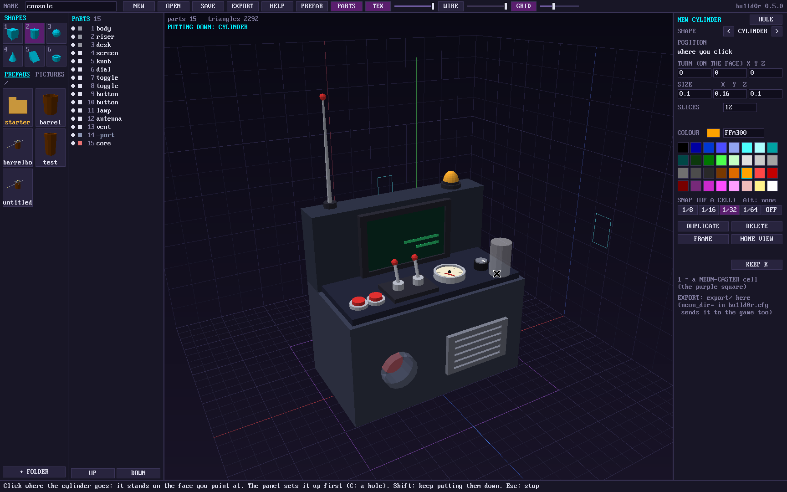

1. Pick a shape in the bin (top left) or press 1-6.
2. Set it up in the panel on the right before you click: its size, its
   own turn, slices, colour, or HOLE. The ghost waits where it was while
   you type.
3. Click where it goes. It stands on the face under the pointer, standing
   out from it (here, the desk's slope), or on the grid.
4. Shift+click keeps putting more down; Esc stops.

### More shapes: dice, stars, gears...

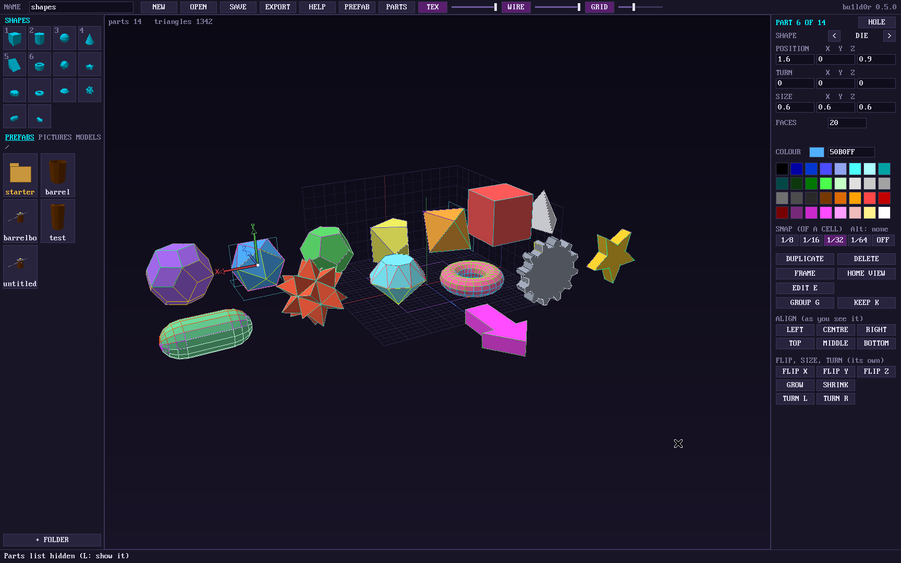

After the first six in the bin come DIE, STAR, GEAR, DONUT, DIAMOND,
SPIKE, PILL and ARROW. Each has its own fields in the panel:

- **DIE:** FACES - 4, 6, 8, 10, 12, 20 or 30 (the wheel steps through
  them). It rests on one face, as a die does.
- **SPIKE:** a die with a point on every face (SPIKES, LENGTH).
- **STAR, GEAR:** POINTS / TEETH, and INNER / DEPTH for how far in they go.
- **DONUT:** SLICES and HOLE.  **DIAMOND:** SIDES and TOP (its table).
- **PILL, ARROW:** ROUND for the ends; HEAD for the arrow's head (it
  points to the front).

E turns any of them into a mesh part, to edit like any other.

### Selecting, moving and lining up

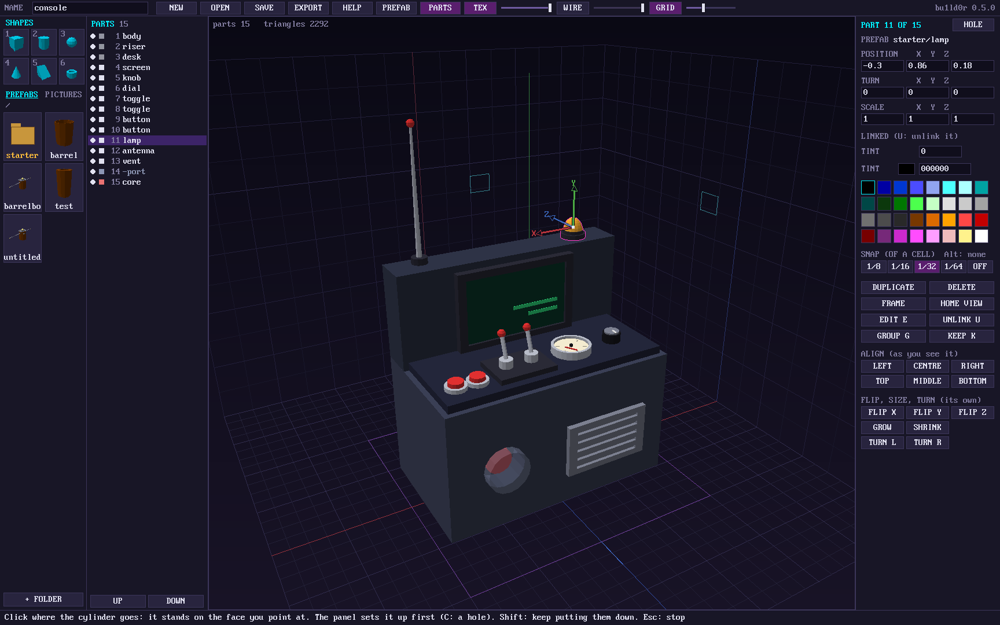

- Click a part to select it (Shift adds, Tab goes to the next). The parts
  list (L) between the bin and the view picks parts hidden inside others.
- Drag it across the ground (Shift: up and down), or drag one of the
  arrows to keep it on that axis (or hold X, Y or Z while dragging).
  Moves snap to the SNAP step; Alt for none.
- The panel has exact numbers (type, or the wheel over a field), ALIGN
  (left / centre / right / top / middle / bottom as you see it), and
  FLIP, GROW / SHRINK, TURN L / R.
- G groups the selection; GRID shadows it on the floor and walls so you
  can see where it is from any angle.
- Ctrl+Alt shows the selection box's middle, side middles and corners;
  Ctrl+Alt+click one (or a spot on the shape) and SCALE grows from there,
  the far side staying put, and TURN goes round it.
- SAME gives every selected part the first one's place, size or turn on
  the axes you pick; AS SEEN matches width, height or depth on screen.

### Prefabs

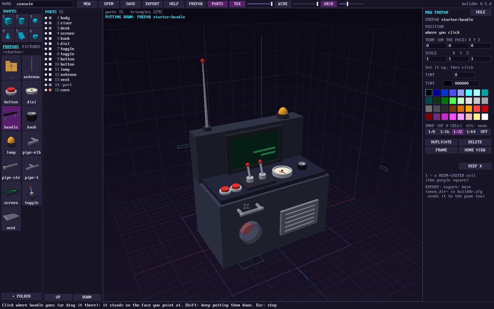

- PREFAB at the top (Ctrl+Shift+S) saves the model into the bin's open
  folder. The bin starts with a `starter/` folder.
- Click or drag a prefab onto a face. It stays linked: change the prefab
  (right-click it, EDIT IT) and every model using it follows.
- U (UNLINK) makes a placed prefab the model's own parts; TINT shades it
  towards a colour.

### Holes and merging

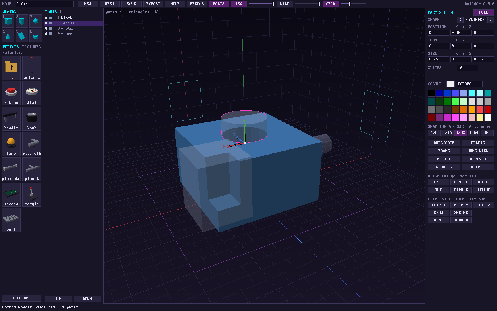

- C (or HOLE) makes a part a hole: it's cut out of every solid part
  before it in the parts list. It stays a part, shown see-through grey,
  so you can still move or size it.
- A hole put down on a face drills into it.
- K (KEEP) keeps only the overlap instead.
- A (APPLY) cuts it for good, leaving mesh parts you can edit.
- M (MERGE) is the boolean add: select two or more overlapping parts and
  they become one mesh part, the faces inside the overlap gone. Colours
  and pictures stay.

### Editing faces, edges and points

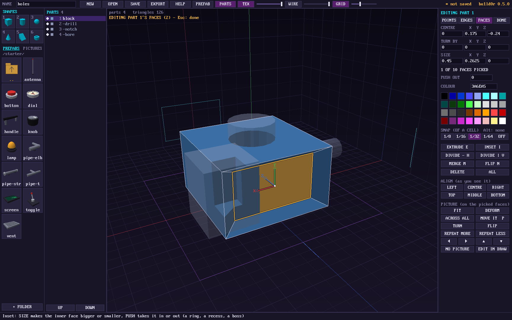

1. Select one part and press E: it becomes a mesh part and its faces show.
2. Press 1 for points, 3 for edges, 2 for faces (Tab goes round them).
   Click picks, Shift adds, drag a box round several. In edges,
   Ctrl+click picks an edge's whole loop (Shift+Ctrl adds another).
3. Drag what's picked to move it, or use the panel: CENTRE, TURN BY,
   SIZE, PUSH OUT.
4. The tools: EXTRUDE (E), INSET (I), BEVEL (B), DIVIDE across / down
   (H / V), MERGE (M), FLIP (N), DELETE, and for edges SPLIT (S),
   CONNECT (J) and LOOP (O). The palette colours the picked faces. Esc
   lets go, then leaves.

The recess on the front here is an INSET face pushed in with PUSH OUT.

### Bevel

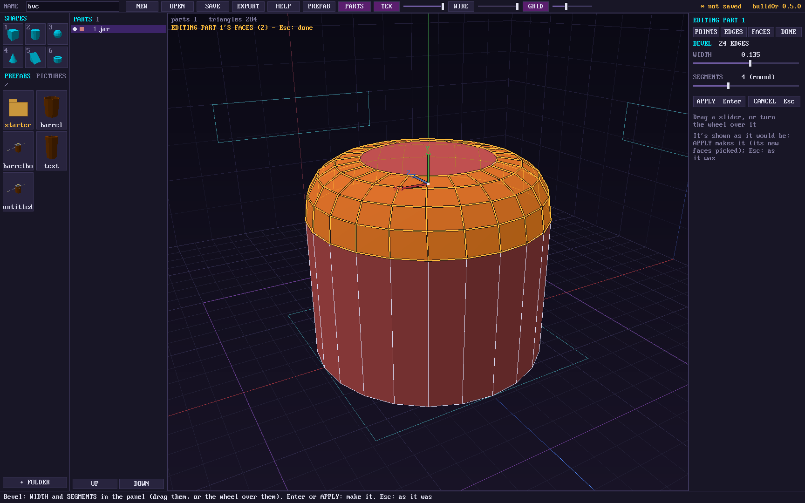

Bevel cuts a sharp edge into a strip of faces: a flat chamfer, or a
rounded edge.

1. In E, pick edges (3), or faces (2) to bevel all their edges.
2. Press B (or BEVEL). The panel changes to BEVEL mode.
3. Drag WIDTH and SEGMENTS (or the wheel over them). SEGMENTS 1 is a flat
   chamfer; more makes it round. The view shows the result as you go.
4. Enter (or APPLY) makes it, one undo step. The new faces are left
   picked, ready to colour or put a picture on. Esc puts it back as it
   was.

Where bevelled edges meet at a corner, a corner face fills the gap. A
picture on a bevelled face stays on, trimmed to the face that's left.

### Loop cut, split and connect

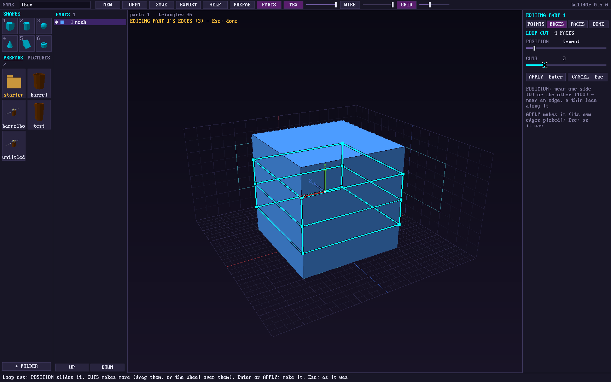

More edges where you need them:

- **LOOP (O):** click an edge (3: edges), press O. A ring of new edges
  goes round the part across it, through each four-sided face in turn,
  until it comes back round or meets a face that isn't four-sided.
  POSITION slides it from one side of those faces to the other - close to
  an edge, it makes a thin face along that edge - and CUTS makes more,
  evenly spaced. Enter (or APPLY) makes it, with the new edges picked;
  Esc drops it.
- **SPLIT (S):** each picked edge gets a point in its middle, shared by
  the faces on both sides (S again: quarters). Press 1 and drag the new
  point to pull the edge apart.
- **CONNECT (J):** a new edge across a face - between the middles of two
  of its picked edges, or between two of its picked corners (1: points).

### Pictures on faces

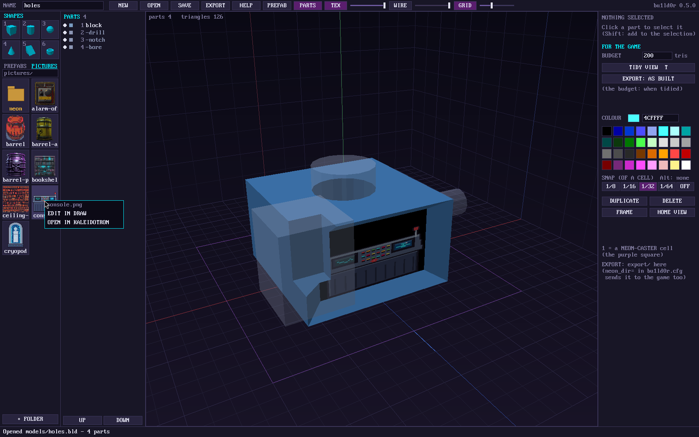

- The bin's PICTURES tab shows the PNGs in `pictures/`. Drag one onto a
  face, or click it and then click faces. Dropping a PNG from the desktop
  onto the window works too.
- In E with faces picked, the panel's PICTURE buttons fit it (FIT,
  DEFORM, ACROSS ALL), move it by hand (MOVE IT, or P), turn, flip and
  repeat it.
- Right-click a picture: EDIT IN DRAW opens it in DRAW, and every save
  there shows here at once. OPEN IN KALEIDOTRON shows its folder.

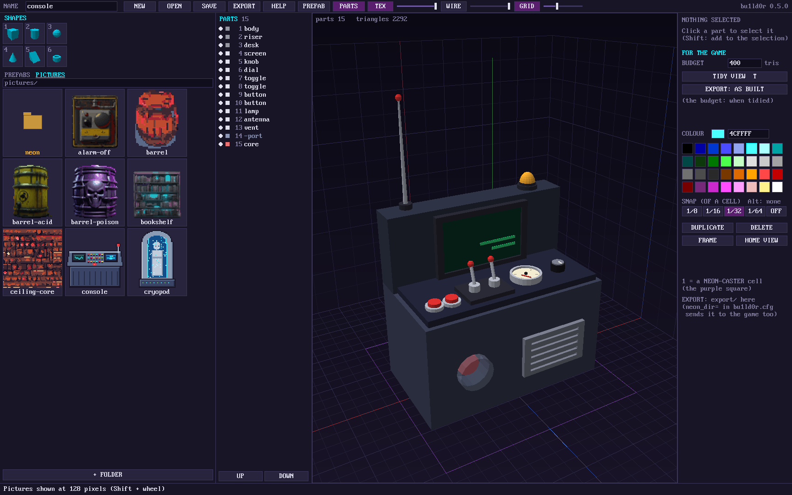

Drag the bin's edge to make it wider, and Shift + wheel over the pictures
to make the tiles bigger or smaller (40 to 256 pixels). The path box
under the tabs opens any folder of PNGs.

### Painting a face's picture

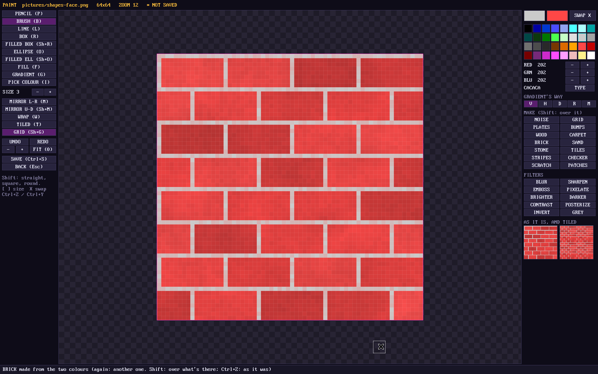

1. Point at a face and press Ctrl+P (or pick faces in E and press
   Ctrl+P, or PAINT IT in the panel, or right-click a picture in the bin).
   A face with no picture gets a new one in its colour, put on first.
2. The picture fills the window. Left button paints in the first colour,
   right in the second; Ctrl+click picks a colour up. The wheel zooms,
   middle drag moves it.
3. Tools: pencil, brush, line, box, ellipse (filled or not), fill,
   gradient (down, across, slanted, round, or out from the middle), pick.
   Mirror left-right or up-down, wrap round the edges, or see it tiled.
4. MAKE makes a whole picture from the two colours: noise, grid, plates,
   bumps, wood, carpet, brick, sand, stone, tiles, stripes, checker,
   scratches, patches. Each repeats without a seam; click again for
   another. FILTERS: blur, sharpen, emboss, pixelate, brighter, darker,
   contrast, posterize, invert, grey. CLEAN / RAND: only the two colours,
   or random tints too; SIZE: how big its bricks, tiles, rings come out.
   With a gradient, drag from where it starts to where it ends, then drag
   its ends or its line to change it; it can repeat (PAD, REP, BNC).
   SELECT (S) drags a box: move it, copy it (Alt), flip, turn or scale it.
5. Ctrl+S saves the PNG and the faces show it. Esc goes back (it asks
   first if it isn't saved).

### Seeing it: TEX, WIRE, GRID

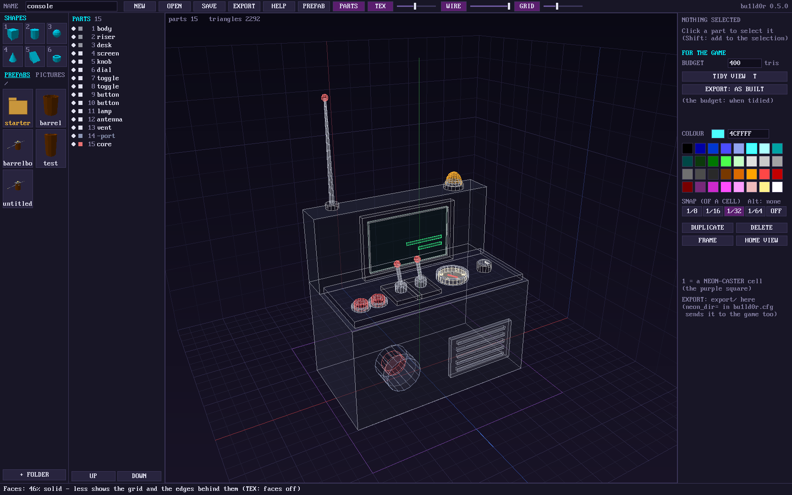

The buttons at the top each have a slider beside them:

- **TEX** (Shift+W): the faces on or off. The slider sets how solid they
  are; less shows the grid and the edges behind.
- **WIRE** (W): every part's edges drawn over it, each pixel the opposite of the one under it, so they show on white faces and the dark backdrop alike.
- **GRID**: the grid up the two walls behind the model, with the
  selection shadowed on them.

### Opening NEON-CASTER's props

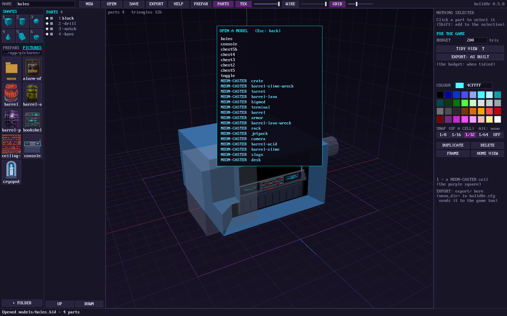

OPEN (Ctrl+O) lists your models, then NEON-CASTER's props. A prop opens
with its texture on it, ready to change and EXPORT back to the game (see
[NEON-CASTER](#neon-caster)).

### The MODELS tab

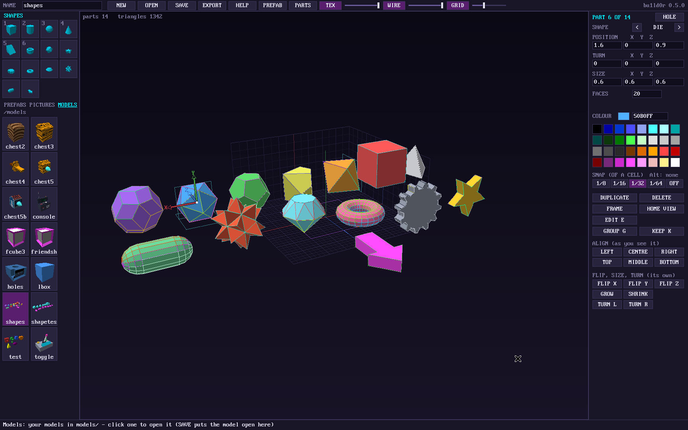

The bin's third tab shows every model in `models/` as a picture; click
one to open it (the one open is lit). If the model open isn't saved, the
first click says so and a second opens it anyway.

### SVGs made thick

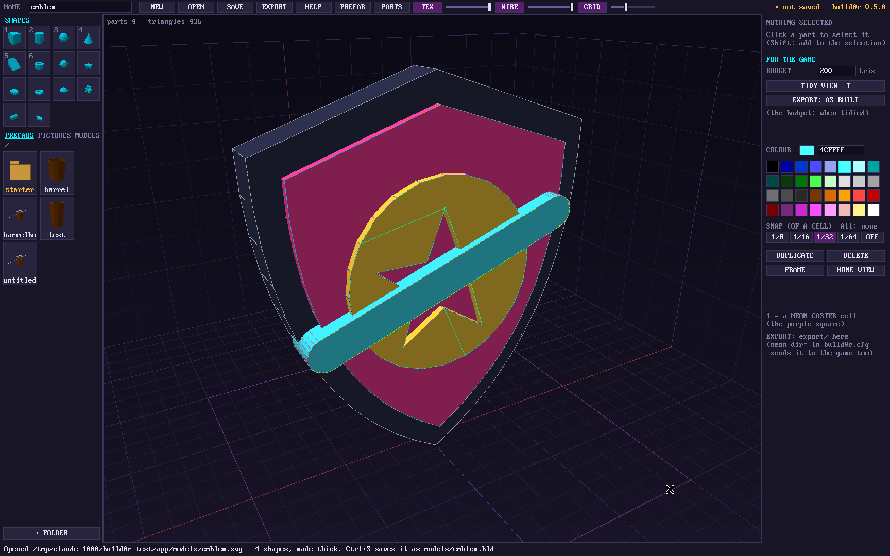

OPEN lists the SVGs in `models/`, and an SVG dropped on the window opens
too. Each filled shape becomes a mesh part, all of them one group:

- Paths (curves and arcs too), rects (rounded too), circles, ellipses,
  polygons and polylines, through their transforms and their groups'.
- Holes stay holes (a ring, the inside of a letter O, a star cut out).
- The fill colour comes with it; a gradient gives the average of its
  colours. Glows and shadows (a `filter`) and see-through overlays are
  left out, as are lines with no fill.
- It's 1 cell across, a tenth of that thick, facing the front. A shape
  lying over earlier ones stands a step further out, so the layers don't
  fight.

Then E extrudes, insets and bevels its faces as any mesh part's, and
Ctrl+S saves it as a model.

### Your own shapes: the pen and text

- **The pen (P):** click corners on the ground (click and drag for a
  curve); click the first point again and the outline becomes a flat part,
  ready to thicken, extrude and bevel.
- **Text (X):** type, pick a font from the list in the view (fonts in
  `fonts/`, DRAW's fonts, and the system's), click where it starts, Enter.
  Each letter is a flat mesh part, all one group: Alt+click one letter to
  move it on its own. Up / Down sizes it, Left / Right thickens it, Tab
  stands it up.

### Reference pictures

The view's top right has **[REF] (slider) [TR] [B] [L] [R]**: a picture
on the ground (B), on the back wall (L) or on the side wall (R), drawn
see-through behind the model so you can build over it from any angle.

- B, L or R picks which one the rest works on. REF picks a picture from
  disk (PNG, JPG, BMP...); a PICTURES tile dragged onto REF, or a file
  dropped on it, works too.
- The slider sets how solid it is (middle click: 50%).
- TR moves it: drag in the view, or the arrow keys; the wheel sizes it.
- Shift+click B, L or R hides that one; Shift+click REF hides them all;
  right-click REF takes it off.
- They're saved with the model.

### Help in the program

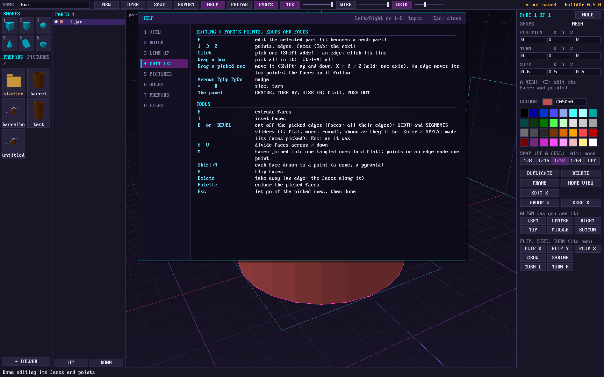

H (or F1) shows every key by topic: click a topic, or Left / Right, or
1-9. The same list is below.

## Keys

This list is the in-program HELP. Click a topic to open it.

<!-- keys:start -->
<details>
<summary><b>VIEW</b></summary>

#### GETTING ROUND

| Keys | What it does |
|---|---|
| Right drag | turn round |
| Middle drag | pan (or Shift + right drag) |
| Wheel | nearer / further |
| F | frame what's selected (nothing selected: all of it) |
| Home | the start view |
| Arrows | turn round by steps (with nothing selected) |

#### THE NUMPAD

| Keys | What it does |
|---|---|
| 1 / 2 / 3 | the start view, from above, from under |
| 4 / 6 | from the left, from the right |
| 7 / 8 / 9 | from above: the front-left corner, the front, the front-right corner |
| 5 | flat (no perspective) / perspective |
| 0 / . | frame it all; the start view again |
| + / - / * / / | nearer, further, turn right / left 15 |
| Enter | frame what's selected |
| Num Lock | on or off: the same (the numpad's keys tell themselves apart from Home, the arrows...). Typing in a box: they type |

#### SEEING IT

| Keys | What it does |
|---|---|
| TEX / Shift+W | the faces on / off - the slider beside it: how solid (less shows the grid and the edges behind) |
| W or WIRE | each part's edges drawn over it, each pixel the opposite of what's under it (so they show on white or dark) - the slider: how strong |
| GRID | the grid up the two walls behind, and what's selected shadowed on the floor and walls - where it is, against the lines. The ground's grid never ends: it thins and fades out with distance |
| Ctrl+H / GUIDES | hide every guide (edges, points, picked colours, outlines, the widget) to see just the model; again: back |
| The bin's edge | drag it: wider or narrower (no narrower than at first; remembered) |
| The sliders | drag one, or the wheel over it. TEX, WIRE, GRID and their sliders are remembered |
| L or PARTS | the parts list |
| T | the model as it'll be exported, tidied |

#### THE WINDOW

| Keys | What it does |
|---|---|
| F11 | full screen (any size works: the view takes the room) |
| Ctrl+ / Ctrl- | everything bigger or smaller |

#### SIZES

Sizes are in NEON-CASTER cells: 1 is a wall's width. The model's foot is the middle of the purple square; its front faces the short blue line (-Z).

</details>

<details>
<summary><b>BUILD</b></summary>

#### PUTTING SHAPES DOWN

| Keys | What it does |
|---|---|
| 1 - 6 | a shape (or click one in the bin), then click where it goes: it stands on the face you point at |
| Shift+click | keep putting them down |
| Esc | stop |
| The panel | sets it up before the click: size, turn, colour... |

#### MORE SHAPES (the bin, after the first six)

| Keys | What it does |
|---|---|
| DIE | 4, 6, 8, 10, 12, 20 or 30 faces: the buttons under FACES (or the wheel on it). It sits on a face |
| SPIKE | a die with a point on every face: SPIKES, and LENGTH |
| STAR / GEAR | POINTS / TEETH, and INNER / DEPTH: how far in they go |
| DONUT | SLICES round, HOLE: how big its middle |
| DIAMOND | SIDES, TOP: how wide its flat top |
| PILL / ARROW | ROUND: how round its ends;  HEAD: how long the arrow's head (it points to the front) |
| Fitting the grid | every shape fills its box, and its sizes land on the snap (x and z two steps, y one), so its sides sit on grid lines |

#### MOVING PARTS

| Keys | What it does |
|---|---|
| Click | select (Shift: add) |
| Drag a box | from empty space: every part whose middle is in it (Shift: added) |
| Tab | the next part |
| Drag | along the ground (Shift: up and down) |
| Alt + drag | off the grid (no snap) |
| Arrows | nudge across a grid step;  PgUp / PgDn: up and down (Shift: 10 steps, Alt: a tenth - the same for the wheel and GROW) |
| R / Shift+R | turn 15 degrees |
| FLIP X Y Z | (the panel) each part mirrored in its own axes, about its own middle - a shape that isn't the same mirrored becomes a mesh part |
| GROW / SHRINK | a grid step bigger / smaller each way, standing where it stands (several: as one piece) |
| TURN L / R | 90 degrees round the up axis (Shift: 15) |
| = / - | bigger, smaller |
| Ctrl+D | copy |
| Ctrl+C / X / V | copy, cut, paste the selected parts (pasted two snap steps along, selected; in E: a face's picture) |
| Delete | take away |

#### THE PANEL

| Keys | What it does |
|---|---|
| Type | a number, then Enter |
| Wheel | over a field: a step (a turn: 1, Shift 10, Alt 0.1) |
| Middle click | a field back to usual |
| 1/8 .. 1/64 / OFF | (the top bar, beside GRID) what moves and sizes snap to, in cells - and the ground's finest lines |

</details>

<details>
<summary><b>LINE UP</b></summary>

#### ALONG ONE AXIS

| Keys | What it does |
|---|---|
| The arrows | on what's selected: drag X (red), Y (green) or Z (blue) and it moves only that way |
| Hold X, Y, Z | while dragging: kept to that axis. Its line is drawn, with a tick at each snap step |

#### TRANSFORM (the panel)

| Keys | What it does |
|---|---|
| MOVE / SCALE / TURN | what dragging the widget does |
| X / Y / Z | which ways (any of them on): the widget shows only those. SCALE with only Y: taller; TURN: 15 at a time (Alt: 1) |

#### ALIGN (the panel - as you see it)

| Keys | What it does |
|---|---|
| LEFT CENTRE RIGHT | across the screen |
| TOP MIDDLE BOTTOM | up the screen |
| Parts | each moved (a group as one); one alone lines up with the model |
| In E | points lined up; edges and faces each moved whole; one alone lines up with its part |

#### TYPING IN A BOX

| Keys | What it does |
|---|---|
| Click | the cursor goes there (double click: all of it; Shift+click: picks to there; drag: picks) |
| Left Right Home End | move the cursor (Shift: picking letters; Ctrl: a word at a time) |
| Ctrl+A C X V | all, copy, cut, paste. Backspace / Delete (Ctrl: a word) |

#### SEEING WHERE

| Keys | What it does |
|---|---|
| GRID | shadows of what's selected on the floor and walls |

#### WHERE IT GROWS AND TURNS FROM

| Keys | What it does |
|---|---|
| Ctrl+Alt | shows the selection box's points: the middle, each side's middle, each corner |
| Ctrl+Alt+click | one of them (or a spot on the shape) - the widget sits there: SCALE grows from it (that side stays put), TURN goes round it. It follows a MOVE; the middle, or another selection: back to usual |

#### SAME (the panel: as the first picked)

| Keys | What it does |
|---|---|
| PLACE SIZE TURN | each selected part given the first one's place / size / turn - on the X Y Z beside them |
| WIDTH HEIGHT DEPTH | (AS SEEN) each part's reach across / up / into the screen made the first one's |

#### GROUPS

| Keys | What it does |
|---|---|
| G | group the selected parts (G on a group: ungroup) |
| Click | picks the whole group (Alt+click: one part) |

</details>

<details>
<summary><b>EDIT (E)</b></summary>

#### EDITING A PART'S POINTS, EDGES AND FACES

| Keys | What it does |
|---|---|
| E | edit the selected part (it becomes a mesh part) |
| 1 / 3 / 2 | points, edges, faces (Tab: the next) |
| Click | pick one (Shift adds) - an edge: click its line |
| Ctrl+click | an edge: its whole loop - on across four-sided corners till it comes round or stops (Shift+Ctrl: adds it) |
| Drag a box | pick all in it;  Ctrl+A: all |
| Drag a picked one | move it (Shift: up and down; X / Y / Z held: one axis). An edge moves its two points: the faces on it follow |
| Arrows PgUp PgDn | nudge |
| = / - / R | size, turn |
| The panel | CENTRE, TURN BY, SIZE (0: flat), PUSH OUT |

#### TOOLS

| Keys | What it does |
|---|---|
| E | extrude faces |
| I | inset faces |
| B or BEVEL | cut off the picked edges (faces: all their edges): WIDTH and SEGMENTS sliders (1: flat, more: round), shown as they'll be. Enter / APPLY: made (its faces picked); Esc: as it was |
| S or SPLIT | each picked edge cut in two at its middle - the faces both sides get the point (S again: in four). 1, then drag the new point |
| J or CONNECT | a new edge across a face: between the middles of two of its picked edges (3), or two of its picked corners (1) |
| O or LOOP | a ring of new edges round the part, across the picked edge, through each four-sided face in turn: POSITION slides it (near an edge: a thin face along it), CUTS makes more. Enter / APPLY: made; Esc: as it was |
| H / V | divide faces across / down |
| M | faces joined into one (angled ones laid flat); points or an edge made one point |
| Shift+M | each face drawn to a point (a cone, a pyramid) |
| N | flip faces |
| Delete | take away (an edge: the faces along it) |
| Palette | colour the picked faces |
| Esc | let go of the picked ones, then done |

</details>

<details>
<summary><b>PICTURES</b></summary>

#### PUTTING ONE ON

| Keys | What it does |
|---|---|
| PICTURES tab | in the bin: the PNGs in pictures/ |
| Drag one | onto a face |
| Click one | then click faces (Shift: every face of the part); Esc: stop |
| Shift + wheel | over the pictures: bigger or smaller tiles (drag the bin wider for more across) |
| Drop a PNG | from the desktop onto the window: added, and put on the face it lands on |

#### FOLDERS

| Keys | What it does |
|---|---|
| The path box | under the tabs: click it, type or paste (Ctrl+V) any folder, Enter: its PNGs in the bin. ~ is home; a .png's path opens its folder. Remembered |
| PICTURES tile | back to pictures/ from a folder outside it |
| From outside | a picture from another folder is copied into pictures/ when you put it on |
| Drop a folder | on the window: it opens in the bin |
| Right-click | a picture: EDIT IN DRAW, OPEN IN KALEIDOTRON (its folder, it picked). A folder, or the bin's empty space: OPEN IN KALEIDOTRON |

#### ON THE PICKED FACES (E, faces)

| Keys | What it does |
|---|---|
| FIT | fit it to each face (squared to the face's box) |
| DEFORM | its four corners pinned to the face's corners: it bends to the shape (a slanted or pointed face) |
| MOVE IT or P | move it by hand: drag a picked face to slide it, the wheel sizes it, Shift + wheel turns it (Alt: off the picture's pixels). P again: done |
| ACROSS ALL | one picture spread across all of them |
| TURN / FLIP | a quarter turn; mirrored |
| REPEAT | more or fewer times across |
| Arrow buttons | slide it |
| NO PICTURE | take it off (a colour from the palette does too) |
| Ctrl+C | copy the picture on the picked face (or the one pointed at) as it lies on it - how big, turned, where |
| Ctrl+V / Ctrl+Shift+V | put it on the picked faces (none picked: the one pointed at); on every face of the part |

#### PAINTING ONE HERE

| Keys | What it does |
|---|---|
| Ctrl+P / PAINT IT | paint the picture of the face under the pointer (in E: of the picked faces) - no picture on it: a new one, its colour, put on first. The PAINT topic has the keys |

#### PAINTING ONE IN DRAW

| Keys | What it does |
|---|---|
| EDIT IN DRAW | (E, faces picked) opens the face's picture in DRAW - no picture on it: a new one, the face's shape and colour, put on first. Save it in DRAW (Ctrl+S) and it shows here straight away |

</details>

<details>
<summary><b>PAINT</b></summary>

#### THE PAINTER (Ctrl+P on a face)

| Keys | What it does |
|---|---|
| Left / right button | paint in the first / second colour |
| Ctrl+click | pick up a colour (with any tool) |
| Wheel | zoom (at the pointer);  middle drag or Space + drag: move it;  0: fit;  - +: zoom |
| Ctrl+S | save: it shows on its faces.  Esc: back (asks first if not saved) |
| Ctrl+Z / Ctrl+Y | undo, redo |

#### TOOLS

| Keys | What it does |
|---|---|
| P / B | pencil, brush ([ ]: its size) |
| L | line (Shift: straight or at 45) |
| R / Shift+R | box, filled box (Shift while dragging: square) |
| O / Shift+O | ellipse, filled ellipse |
| F | fill the colour where you click |
| G | gradient, first colour to second - V H D R M: down, across, slanted, round, from the middle. Click: the region FILL would take; Shift+click: the whole picture; right click: the other way |
| Gradient: drag | from where it starts to where it ends (any way). Then drag an end: stretch / turn it; the line: move it.  x - +: repeat it 1-16 times;  PAD REP BNC: past its ends the end colour, again, back and forth |
| I | pick a colour |
| X | swap the two colours.  The palette: left / right click.  TYPE: a hex colour |
| CLEAR / Del | the picture filled with the second colour (Shift: see-through) |

#### HOW IT PAINTS

| Keys | What it does |
|---|---|
| M / Shift+M | mirror left-right / up-down |
| W | wrap round the edges (paint off one side, on at the other) |
| T | tiled: seen with its neighbours, as it repeats |
| Shift+G | the pixel grid |

</details>

<details>
<summary><b>PAINT 2</b></summary>

#### SELECT (S)

| Keys | What it does |
|---|---|
| Drag | a box.  Drag inside it: move what's in it (Alt: a copy) |
| Ctrl+C X V / Ctrl+A | copy, cut, paste (at the pointer), all.  Del: empty it |
| FLIP L-R / U-D / TURN | the box's pixels mirrored, turned;  x2  1/2: bigger, smaller |
| Enter / Esc | let go (another tool does too) |

#### MAKE AND FILTERS (the right)

| Keys | What it does |
|---|---|
| MAKE | a new picture from the two colours: NOISE GRID PLATES BUMPS WOOD CARPET BRICK SAND STONE TILES STRIPES CHECKER SCRATCH PATCHES - each repeats seamlessly, new each click. Shift: over what's there |
| CLEAN / RAND | MAKE with only the two colours and its shading; or with random tints (each brick a little different) |
| SIZE x | how big MAKE's parts come out (bricks, tiles, rings...);  STR: how strongly Shift+MAKE lays it over what's there |
| FILTERS | BLUR SHARPEN EMBOSS PIXELATE BRIGHTER DARKER CONTRAST POSTERIZE INVERT GREY |

</details>

<details>
<summary><b>PEN, TEXT</b></summary>

#### PEN: YOUR OWN FLAT SHAPE

| Keys | What it does |
|---|---|
| P or the pen tile | (after the shapes) draw an outline on the ground, on the snap (Alt: a tenth of it) |
| Click | a corner;  click + drag: a curve (its handles mirrored; Ctrl: only the side you drag) |
| The first point | click it (or Enter) to close: a flat part a snap step thick, selected |
| Then | thicker: TRANSFORM SCALE with only Y on (or its Y size); E to extrude, bevel... |
| Backspace / Esc | back a point; let the outline go (Esc again or P: put the pen away) |

#### LETTERS IN A FONT

| Keys | What it does |
|---|---|
| X or the Aa tile | (after the pen) then type |
| The font list | (in the view) click one, the wheel over it, or PgUp / PgDn - fonts from fonts/, DRAW's fonts, and the system's |
| Click | the ground: where it starts (it follows the pointer till then) |
| Up / Down | bigger, smaller (Shift: by more) |
| Left / Right | thinner, thicker |
| Tab | lying on the ground / standing up |
| Enter | made: each letter a flat mesh part, all one group, each named by its letter |
| Then | click: the word; Alt+click: one letter, to move, turn, colour... E: extrude, bevel it |
| Esc | stop |

</details>

<details>
<summary><b>REFERENCE</b></summary>

#### A PICTURE TO MODEL OVER (the view's top right)

| Keys | What it does |
|---|---|
| B / L / R | which one the rest works on: the ground, the back wall (left as the view opens), the side wall (right). The walls are the far ones: they swap round as you turn |
| REF | a picture from disk for it (PNG, JPG, BMP...) - or drag a PICTURES tile onto REF, or drop a file on it |
| The slider | how solid it is (the wheel: 5 at a time; middle click: 50) |
| TR | move it: drag in the view (on its plane; on an arrow: only that way), the arrows a grid step at a time, the wheel or PgUp / PgDn sizes it. Esc / TR: done |
| Shift+click B L R | hide / show that one;  Shift+click REF: all of them |
| Right-click REF | take it away |
| Saved | with the model (its file stays where it is: the model keeps the path) |

</details>

<details>
<summary><b>HOLES</b></summary>

#### HOLES

| Keys | What it does |
|---|---|
| C or HOLE | a hole: cut out of the solid parts before it in the list (so a part after it can sit in it). Seen see-through grey (click to pick it) |
| Put down as one | it drills into the face it's put on |
| K or KEEP | only where it overlaps the parts before it stays |
| M or MERGE | (two or more solid parts selected) made one mesh part: their outsides kept, the insides where they overlap gone - a boolean add. Colours and pictures kept; Ctrl+Z: back |
| A or APPLY | a hole or KEEP cut for good (mesh parts, editable) - select solid parts with it and it cuts just those, wherever they're listed |
| In a group | a hole cuts every solid part of its group, wherever it's listed - and nothing else |

#### THE PARTS LIST (L)

| Keys | What it does |
|---|---|
| The dot | show / hide |
| The square | lines only |
| Double-click | rename |
| UP / DOWN | earlier or later in the list |

</details>

<details>
<summary><b>PREFABS</b></summary>

#### PREFABS (the bin, under the shapes)

| Keys | What it does |
|---|---|
| PREFAB | (Ctrl+Shift+S) this model into the bin's open folder |
| Click or drag one | onto a face: it stands out from it, linked |
| Right-click one | EDIT IT, RENAME / MOVE (a folder in the name moves it; every use follows) |
| U or UNLINK | a prefab put down made the model's own parts |
| TINT | (the panel) its colours mixed towards one, by AMOUNT |
| Folders | click to go in, .. back up, + FOLDER makes one |

</details>

<details>
<summary><b>FILES</b></summary>

#### THE MODEL

| Keys | What it does |
|---|---|
| Ctrl+N / NEW | a new model |
| Ctrl+O / OPEN | open one (models/, and NEON-CASTER's props) |
| MODELS tab | in the bin: every saved model, as a picture - click one to open it (not saved: asks first). Drag one into the view: its parts added to this model, one group |
| An SVG | OPEN one in models/, or drop one on the window: each filled shape made thick (a mesh part, all one group, 1 cell across, facing the front). Holes stay holes; shapes over others stand a step out. Then E: extrude, inset... and Ctrl+S saves it as a model |
| Ctrl+S / SAVE | save (models/NAME.bld) |
| Ctrl+Z / Ctrl+Y | undo, redo |
| Ctrl+A | select all |
| Ctrl+Q | quit |

#### EXPORT

| Keys | What it does |
|---|---|
| Ctrl+E / EXPORT | export/NAME.obj - and NEON-CASTER's models/ when neon_dir= is set in bu1ld0r.cfg |
| TIDIED | (the panel, nothing selected) exported with fewer faces, down to its BUDGET; T: see it so |

</details>
<!-- keys:end -->

## In detail

- **Put a shape down:** pick it on the left (or press 1-6), then click where it goes. It stands on the face you point at, standing out from it, or on the grid. You can also drag it straight from the bin. Shift keeps putting more down; Esc stops.
- **Set it up first:** while you're putting a shape down (nothing selected), the panel is the new shape's: its size, its own turn (on top of the face's), slices, amount, colour, HOLE. Type, use the wheel, or middle-click a field, then click where it goes. The ghost stays where it was while you work in the panel.
- **Holes:** C (or HOLE in the panel) makes the selection a hole: it's cut out of every solid part before it in the parts list, and its walls take that part's colour. It stays a part: move it, size it, make it solid again (C). A hole shows as see-through grey; click it to pick it. One put down onto a face goes into it, top flush, like a drill: a narrow cylinder on a cylinder's top as tall as it goes straight through. Prefabs can hold holes, and a hole can be a prefab.
- **KEEP** (K): the part keeps only where it overlaps the solid parts before it (an intersection); shown see-through green.
- **APPLY** (A, the panel's APPLY with a hole selected): the hole (or KEEP) cut for good. The parts it cut become mesh parts with the cut in them, and the hole goes. One undo step.
- **Groups** (G): the selection becomes a group. A click picks the whole group (Alt+click: just one part), and a hole in a group cuts only its own group. G on a group ungroups it. In the parts list a group is a folder: click it to pick the whole group, its triangle folds it, its dot hides or shows all of it; click a part inside it to work on just that part.
- **Turning several parts:** with more than one part selected, R and the panel's TURN ALL AS ONE turn them together round their middle, as one object (not each on its own spot).
- **Editing faces and points** (E, or EDIT in the panel, with one part selected): the part becomes a mesh part (a shape's size and turns are kept) and its faces show. 2: faces, 1: points, 3: edges, Tab goes round them. Click picks (Shift adds; an edge: click its line), drag a box round several, Ctrl+A all. Drag a picked one to move them (Shift: up and down), or the arrows and PgUp/PgDn. An edge moves its two points, so the faces on it follow (a box's top edge dragged out makes a wedge). The part's edges are drawn over it in a colour that shows on it, and what's picked is drawn wide: faces orange, edges and points cyan. A part set to lines only in the parts list can still have its faces picked. The panel has their CENTRE, TURN BY, SIZE (0 flattens them) and PUSH OUT (along the way they face); = and - size them, R turns them. E extrudes the picked faces, I insets them, H and V divide them across and down, M joins picked faces that touch into one (the edges between them gone; faces at an angle are laid flat on the biggest one's plane; picked points or an edge: made one), Shift+M draws each picked face to a point (a cone, a pyramid), N flips them, Delete takes them away (an edge: the faces along it), and the palette colours them. Esc lets go of the picked ones, then leaves. For example, a 12-slice cylinder with its top face picked: SIZE X and Z 0.7 taper it, I insets a smaller face in it, and PUSH OUT -0.8 sinks that one: a cup.
- **Bevel** (B, or BEVEL in E's panel, with edges or faces picked; faces: all their edges): a mode, as MOVE IT is for pictures. Each face beside a picked edge moves in from it by WIDTH, and a strip of SEGMENTS faces fills the gap: 1 is a flat chamfer, more are round. Where bevelled edges meet, a corner face fills in. The view shows it as it'll be while you drag the sliders (or turn the wheel over them); WIDTH goes as far as the faces beside the edge allow. Enter or APPLY makes it (one undo step) and leaves the new faces picked; Esc puts the part back as it was. Pictures on the faces stay on them, trimmed. Edges where the faces are flat to each other, or on the model's open rim, aren't bevelled; nor is one folded flat (two faces back to back, as when a face is inset and then pushed in exactly as far as the inset - push in less and its edges have a corner to cut).
- **Loop cut, split, connect** (E, edges): O (LOOP) puts a ring of new edges round the part across the picked edge, through each four-sided face in turn (until it comes round, or meets a face that isn't four-sided); a mode as BEVEL is: POSITION slides it across those faces (near an edge: a thin face along it), CUTS (1-10) spaces more evenly, Enter or APPLY makes it with its new edges picked, Esc drops it. S (SPLIT) puts a point in the middle of each picked edge, shared by the faces both sides. J (CONNECT) cuts a face in two with a new edge between the middles of two of its picked edges, or between two of its picked corners (in points). Picking two opposite sides of a four-sided face picks all four corners; the clicks say which sides were meant, so the other two aren't counted. Ctrl+click on an edge picks its whole loop: from each end it goes on through the point straight across (only where four edges meet), until it comes round or reaches a point where more or fewer meet; Shift+Ctrl adds the loop to what's picked.
- **Edge lines in E** are drawn dark on light faces and light on dark ones, judged by how solid TEX shows the faces: with TEX off (or faint) they're all light against the dark backdrop.
- **Pictures on faces:** the bin's PICTURES tab shows the PNGs in `pictures/` (in folders: + FOLDER makes one). Drag one onto a face, or click it and then click faces (Shift: every face of that part); Esc stops. Shift + wheel over the pictures makes the tiles bigger or smaller (40 to 256 pixels, as wide as the bin allows; `pic_size=` in bu1ld0r.cfg). A picture on a face that a hole cuts stays on what's left of the face. Drop a PNG from your desktop onto the window and it's copied into `pictures/` and put on the face it lands on. In E with faces picked, clicking a picture puts it straight on them. A shape that gets a picture becomes a mesh part. With faces picked in E the panel's PICTURE buttons: FIT (fills each face's box), DEFORM (the picture's corners pinned to the face's corners, so it bends to a slanted or pointed face), MOVE IT or P (by hand: drag a picked face to slide the picture, the wheel sizes it, Shift + wheel turns it; it snaps to the picture's pixels, Alt: not), ACROSS ALL (one picture over all the picked faces), TURN, FLIP, REPEAT MORE / LESS, the arrows slide it, NO PICTURE. EDIT IN DRAW opens the picked face's picture in DRAW (no picture on it: a new PNG is made first, 64 pixels on its long side, the face's shape and colour, and put on the picked faces); each time DRAW saves it, bu1ld0r shows it. DRAW is `~/git/DRAW/DRAW.run` unless `draw=` in bu1ld0r.cfg says where. A picture changed in DRAW any other way shows when the model is opened again. **Other folders:** the path box under the bin's tabs shows the folder open; click it and type or paste (Ctrl+V) any folder (`~` is home, a PNG's path opens its folder, a `file://` link works too), then Enter. Its PNGs show in the bin (the PICTURES tile goes back to `pictures/`); one you put on a face is copied into `pictures/` first (the same picture already there: that one). The folder is remembered (`pic_outside=` / `pic_dir=` in bu1ld0r.cfg), and a folder dropped on the window opens too. Right-click a picture: EDIT IN DRAW, or OPEN IN KALEIDOTRON (its folder, with it picked); right-click a folder, or the bin's empty space for the one open: OPEN IN KALEIDOTRON (`kaleidotron=` in bu1ld0r.cfg says where it is, else `~/.local/bin/kaleidotron`). The game doesn't repeat textures, so EXPORT cuts a repeated face where the repeats meet.
- **Moving along one axis** (as Blender): what's selected (parts, or the picked points and faces in E) shows a widget of three arrows, X red, Y green, Z blue: drag one and it moves only that way. Or hold X, Y or Z while dragging. The axis is drawn through it, with a tick at each snap step (where it snaps). The grid shows the three axes through the middle: X red, Z blue, Y green going up.
- **The grid** (GRID at the top, on at first; the slider beside it sets how bright its lines are, `grid_bright=` 0-100; `grid_walls=` in bu1ld0r.cfg keeps the choice): the floor's grid is also stood up on the two walls behind the model, an eighth of a cell apart, as tall as the model. What's selected (or the shape being put down, or the picked points in E) is shadowed on the floor and both walls as an outline of its box, with a line down to the floor if it's off the ground - so you can see where it is against the grid's lines from any angle.
- **ALIGN** (the panel, with parts selected or in E): LEFT, CENTRE, RIGHT, TOP, MIDDLE, BOTTOM as you see the model (along the world axis nearest the screen's). Parts: each moved whole (a group as one) to line up with the others; one alone lines up with the rest of the model. In E, picked points are lined up on the line; picked faces move whole, each connected piece of them; one piece alone lines up with its part.
- **The parts list** (L, or PARTS at the top): every part by name, between the bin and the view, so you can pick one hidden inside another. Click to select (Shift adds), double-click to rename. The dot shows or hides a part (the export still has it); the square shows it as lines only. UP and DOWN move the selection earlier or later in the list: a hole cuts only what's above it.
- **Select:** click a part (Shift adds it to the selection; Tab goes to the next).
- **Move:**
  - drag a part to move it across the ground (Shift: up and down);
  - arrows nudge it, and PgUp/PgDn raise and lower it;
  - R turns it 15 degrees;
  - = and - make it bigger or smaller.

  Moves snap to the grid (SNAP in the panel); hold Alt for none.
- **Exact numbers:** the panel on the right has the position, turn, size, slices (round shapes), the amount (a cone's top, a tube's hole, how much of a sphere) and the colour. Click a field and type (Enter), or turn the wheel over it: 1 a step, 10 with Shift, 0.1 with Alt. A middle click puts a field back to its usual value (position and turn 0, the shape's own size, a prefab's scale 1).
- **The view:** right drag turns round it, middle drag (or Shift + right drag) pans, the wheel zooms, F frames the model, Home goes back to the start. At the top, TEX, WIRE and GRID each have a slider beside them (drag it, or the wheel over it); all are remembered in bu1ld0r.cfg (`tex_on`, `tex_op`, `wire_on`, `wire_op`, `grid_walls`, `grid_bright`). TEX (Shift+W) shows the faces or not, its slider how solid they are: less shows the grid through them, and the edges behind them as faint as the faces are see-through. WIRE (W) draws every part's edges over it, each pixel the colour under it with its top bit of red, green and blue flipped (XOR 808080: white gives grey, dark gives light), its slider how strong. With TEX off, clicking still picks parts and faces.
- **Edit:** Ctrl+Z undo, Ctrl+Y redo, Ctrl+D copy, Delete removes, Ctrl+A selects everything.
- **Files:**
  - Ctrl+S saves `models/NAME.bld` (the NAME box at the top);
  - Ctrl+O opens one;
  - Ctrl+N starts a new model;
  - Ctrl+E exports `export/NAME.obj`, `.mtl` and `_tex.png`.
- **Prefabs:**
  - PREFAB at the top (Ctrl+Shift+S) saves the model as `prefabs/NAME.bld`, in the bin's open folder. From then on Ctrl+S saves it there.
  - The bin shows them under the shapes. Click one, or drag it, onto a face: it stands out from that face like a shape does.
  - A prefab in a model stays linked to its file. Move, turn and scale it as one piece (its SIZE fields are its SCALE); right-click it in the bin to open and change it, and every model using it follows.
  - Folders: + FOLDER makes one in the folder that's open; click a folder to go in, `..` to go back up.
  - A prefab that's gone missing shows as a red box, and EXPORT waits until it's back.
  - Right-click one in the bin for EDIT IT or RENAME / MOVE: type a new name, with a folder in it to move it (`panels/big-toggle`). Every model and prefab that uses it is changed to match.
  - U (UNLINK): a prefab put down becomes the model's own parts, as a group (a scale that can't be put on one part makes it a mesh part).
  - A prefab put down has a TINT: the panel's colour, with AMOUNT how far its colours go towards it.
- **The window:** drag it to any size; once you let go, everything is laid out again to fill it (the 3D view takes the room). The UI is drawn at a whole-number scale, so it stays crisp: 2x on a 4K display, chosen for you at first. Ctrl+ and Ctrl- change it. F11 (or Alt+Enter) is full screen. The size and scale are kept in `bu1ld0r.cfg` (`window=`, `ui_scale=`), and whether the parts list is shown (`parts_list=`).
- **Flip, grow, turn:** with parts selected the panel has FLIP X / Y / Z (each part mirrored in its own axes, about its own middle; a shape that isn't the same mirrored - a cone flipped in Y - becomes a mesh part to do it), GROW / SHRINK (a quarter bigger or smaller, standing where it stands; several grow as one piece) and TURN L / R (90 degrees round the up axis, Shift: 15).
- **Typing in a box** (the name, the sizes, the pictures path...): click puts the cursor there (double click picks all of it, drag or Shift+click picks some); Left / Right / Home / End move it (Shift picks, Ctrl goes a word at a time); Ctrl+A / C / X / V; Backspace and Delete (Ctrl: a word).
- **Divide** (E, faces, H across / V down): a four-sided face is cut between its edges' middles; any other shape is cut by a line through its middle, across the screen or down it (a house-shaped end: the house above, a rectangle below).
- **Wider bin:** drag the edge between the bin and the view (or the parts list, if it's shown) - the pointer shows <->. A wider bin shows more tiles across. It goes no narrower than it starts, and is remembered (`bin_w=` in bu1ld0r.cfg). The panel on the right stays as it is.
- **More shapes:** DIE (FACES 4, 6, 8, 10, 12, 20 or 30; the wheel steps through those; a d10 is a pentagonal trapezohedron, a d30 a rhombic triacontahedron; each rests on a face, fitted to its box), SPIKE (a pyramid on each of a die's faces: SPIKES, LENGTH), STAR (POINTS, INNER: how far in the points' roots are), GEAR (TEETH, DEPTH), DONUT (SLICES round, HOLE: how big the middle), DIAMOND (SIDES, TOP: the table's width; the point at the bottom), PILL (lying along X: SLICES, ROUND: how round its ends) and ARROW (pointing to the front, -Z: HEAD, how long its head). In `.bld` they're `die`, `star`, `gear`, `donut`, `diamond`, `spike`, `pill`, `arrow`, with their faces / points in the slices column.
- **Painting a picture** (Ctrl+P with the pointer on a face, or with faces picked in E; PAINT IT in E's panel; PAINT IT in a picture's right-click menu in the bin): the face's picture opens over the whole window. A face with none gets a new PNG in `pictures/` in its colour (64 x 64; from E, 64 on its long side, the picked faces' shape), put on it first. A prefab put down isn't painted where it is: paint it in the prefab (EDIT IT). Left / right button: the two colours (the swatches top right; the palette with either button; TYPE a hex colour; R G B - and + nudge the first, Shift by 1); Ctrl+click picks a colour up with any tool. Tools: PENCIL (P), BRUSH (B, [ ] its size), LINE (L), BOX (R / Shift+R filled), ELLIPSE (O / Shift+O filled) - Shift keeps a line straight or at 45 and a box square -, FILL (F), GRADIENT (G: the first colour to the second over the region FILL would take, Shift+click the whole picture, right click the other way; V H D R M: down, across, slanted, round, out from the middle) and PICK (I). MIRROR L-R / U-D (M / Shift+M), WRAP (W: off one edge, on at the other), TILED (T: seen with its neighbours), GRID (Shift+G). MAKE (14) fills it with a texture made from the two colours, seeded so each click is another, all repeating seamlessly (Shift: half over what's there); FILTERS (10) change what's there. Undo / redo: 40 steps. Ctrl+S saves the PNG and every face with it shows it; Esc asks once if it isn't saved.
- **The MODELS tab** (the bin's third): each model in `models/` as a picture, made one a frame, the open one lit; click to open (unsaved: the first click warns, the second opens). Saving relists it.
- **SVGs:** OPEN (models/*.svg), a drop on the window, or `--open NAME.svg`. Read: path (M L H V C S Q T A Z, either case), rect (rx / ry), circle, ellipse, polygon, polyline; `transform` (matrix, translate, scale, rotate, skewX / skewY) on them and their groups (g, svg, a); fill as an attribute or in `style`, inherited, `#rgb` / `#rrggbb` / `rgb()` / names, a gradient its stops' average. Left out: defs, clip paths, masks, text, shapes with no fill, hidden ones, ones with a filter (glows, shadows), and ones under half opaque. Each shape's outlines are nested by what's inside what: inside an odd number of others is a hole. Each becomes a mesh part (one group), fitted 1 cell across, standing on the ground, 0.1 thick, read the right way round from the front (-Z); a shape over earlier ones it overlaps stands a fiftieth further out. Points closer than a thousandth of its size are made one. Ctrl+S saves it as `models/NAME.bld`.
- **Help:** H (or F1): every key, by topic (VIEW, BUILD, LINE UP, EDIT, PICTURES, PAINT, HOLES, PREFABS, FILES) - click a topic, or Left/Right, or 1-9. Esc closes it.

Sizes are NEON-CASTER map cells: 1 is a wall's width, and the purple
square on the grid is one cell. A model's foot is the middle of that
square, and its front faces -Z (the short blue line).

## NEON-CASTER

Put the game's asset folder in `bu1ld0r.cfg`, beside the program:

```
neon_dir=/home/you/git/neon-caster/neon-caster
```

Then EXPORT also writes:
- `models/NAME.obj`;
- its texture at 64 and 256 (`hd/models/`);
- the 8 pictures round it that the software renderer draws.

### Opening the game's props

OPEN lists the game's props after your own models (`NEON-CASTER crate`...),
read from `neon_dir` (or `neon_in=` in the cfg to read them from somewhere
else; with neither, `~/git/neon-caster/neon-caster/` if it's there). One
opens as a new model: each piece of it that doesn't touch the others is a
mesh part, all of them one group, with the prop's texture on them (copied
to `pictures/neon/NAME.png` the first time; after that the copy there is
used, so changes you make to it in DRAW stay). Edit its faces and points as any mesh part;
extrude, inset, divide, merge and flip keep the texture where it was, and
a colour put on a face takes the texture off it. Joining faces (M) keeps the texture where it runs on across them; where it doesn't, the biggest face's part of the texture is stretched over the joined face. A texture can't be painted in bu1ld0r yet (stage 4): edit `pictures/neon/NAME.png` in DRAW, and OPEN the model again to see it. Ctrl+S saves it as
`models/NAME.bld`. A file's own `.obj` opens the same way (`--open
path/to/x.obj`).

EXPORT keeps the texture as it was, pixel for pixel, and puts the colours
of faces without it in squares of the texture no face uses. When there's
no room (or the model has more than one texture) the texture becomes a grid
of squares, each texture in one, the colours in the last - each texture
then has half the pixels across.

The game draws any decoration or pickup as a model when a `models/NAME.obj`
of its picture's name exists. Until the game can place models of its own
(planned), export under a prop's name (`terminal`, `crate`...) to replace
that prop's model; `git checkout` the game's files to get the old one back.

Keep a prop near 200 triangles: the game works out every corner of every
nearby model each frame. EXPORT sends the model as built, unless its
tidy is on (EXPORT: TIDIED in the panel, with nothing selected; `tidy 1` in
the .bld - the .bld keeps it as built either way). Tidying:
- faces hidden inside other parts, or pressed flat against them, go;
- corners are welded, and flat neighbours of one colour joined and cut
  into as few triangles as they need (no cracks where holes were cut);
- slivers' short edges are collapsed;
- if it's still over the model's BUDGET (the panel, with nothing selected:
  200 to start with, 0 for none), edges are collapsed, the one that moves
  the shape least first, keeping colour borders, until it's in budget or
  the next would show.

Faces with a texture on them are left as they are.

T (TIDY VIEW in the panel) shows the model tidied, with the count before
and after; EXPORT says them too. Still over budget? Fewer slices. Tidying
loses detail - look at it with T before switching it on for the export.

## Command line

```
bu1ld0r.run [FILE.bld | FILE.obj | FILE.svg] [--open NAME | NAME.svg | neon:PROP] [--drop FILE.png] [--save] [--export] [--neon DIR] [--tidy] [--shot FILE.png] [--quit] [--bench N]
```

`--drop FILE.png` acts as if the file were dropped on the window (where
the pointer is a moment later: tests). `--open neon:crate` opens the game's crate; `--save` saves what was opened
(an imported prop as `models/NAME.bld`).

`--tidy` starts in the tidy view (T).

`--export`, `--shot` and `--quit` act a few frames after start-up, for tests.
`--bench N` makes the opened model's triangles N times (holes cut each
time) and writes how long one took to `bench.txt`.
